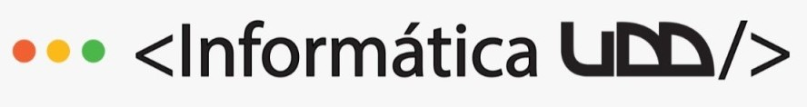

# ChessErcise

   
  

## Tecnologias y Aplicaciones Web y Moviles. Proyecto 2  
Integrantes:  
- Agustin Castro  
- Juan Pablo Molina

Aplicación diseñada para jugar ajedrez con amigos y hacer ejercicio!  
Partidas de ajedrez con desafíos/penalizaciones de ejercicio al perder piezas.
