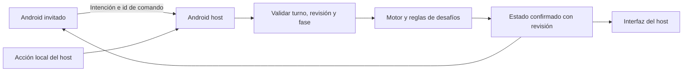

# 03 · Arquitectura Flutter propuesta

> Alcance vigente del 25-10: el usuario reemplazó LAN/Wi-Fi por dos jugadores en un solo dispositivo. La sección 5 y los componentes de transporte del árbol quedan como antecedente descartado para el modo local. Se implementó una partida en memoria que comparte tablero y motor con el puzzle. Primero revisar local, luego online. [Diseño y código vigente](10_multijugador_local_un_dispositivo.md).

Revisión: 25 de octubre de 2026, tras bdda951. Se conserva la arquitectura para **Android, LAN host/cliente, puzzle y online Lichess**. Ya hay código de acceso Supabase, menú y puzzle con tablero/guardado; faltan validación local y funciones restantes. Ver [revisión del merge](08_revision_merge_bdda951.md). El informe 07 describe el estado anterior.

## 1. Forma de programar

La metodología de clases 5–7 es la base obligatoria: main breve, pantallas y widgets separados, modelos Dart, servicios concretos, setState para cambios de una pantalla y ChangeNotifier/Provider cuando varias vistas comparten datos. Usar Navigator y constructor para los detalles, Dio/FutureBuilder para consultas y Supabase para Auth/CRUD privado.

Se mantiene la combinación de capas sencillas y pantallas por funcionalidad: `models/`, `data/`, `logic/` y `presentation/`. Los complementos específicos de ajedrez/red se aíslan y se explican; no se agregan arquitecturas o bibliotecas de estado alternativas.

## 2. Árbol propuesto, creado gradualmente

```text
chess_ercise/                        # Subcarpeta Flutter dentro de ChessErcise/
├── android/                         # Único objetivo de producto
├── lib/
│   ├── main.dart
│   ├── app.dart
│   ├── config/app_config.dart
│   ├── models/
│   │   ├── ejercicio.dart
│   │   ├── puzzle_diario.dart
│   │   ├── progreso_puzzle.dart       # Incorporado: estado local del intento
│   │   ├── configuracion_partida.dart
│   │   ├── captura.dart
│   │   ├── desafio.dart
│   │   └── mensaje_lan.dart
│   ├── data/
│   │   ├── ejercicios_service.dart
│   │   ├── lichess_puzzles_service.dart
│   │   ├── lan_host_service.dart
│   │   ├── lan_client_service.dart
│   │   └── lichess_online_service.dart  # Solo al trabajar online
│   ├── logic/
│   │   ├── ajedrez_service.dart
│   │   ├── puzzle_controller.dart    # Incorporado: ChangeNotifier del puzzle
│   │   └── desafios_service.dart
│   └── presentation/
│       ├── providers/
│       │   ├── auth_provider.dart
│       │   ├── ejercicios_provider.dart
│       │   ├── puzzles_provider.dart
│       │   ├── partida_lan_provider.dart
│       │   └── partida_online_provider.dart
│       ├── screens/
│       │   ├── auth/                  # Gate, correo/ingreso/registro
│       │   ├── home/                  # Menú de modos
│       │   ├── ejercicios/            # Lista, tarjeta y formulario
│       │   ├── puzzles/               # Tarjeta diaria y resolución
│       │   ├── lan/                   # Crear/unirse, sala y errores
│       │   ├── partida/               # Tablero, elección, Listo, resultado
│       │   └── online/                # Autorización y partida Lichess
│       └── widgets/
│           └── tablero_widget.dart   # Adaptación del widget chessground
├── assets/                           # Solo recursos utilizados y declarados
├── test/                             # Modelos, servicios, reglas e interacción
├── pubspec.yaml
└── pubspec.lock
```

Este árbol describe la aplicación **dentro de chess_ercise/**; no implica que los archivos propuestos ya existan. `docs/`, `image/README/` y el futuro `supabase/ejercicios.sql` permanecen en la raíz Git, fuera de esa carpeta. Los comandos Flutter se ejecutan en chess_ercise, no en la raíz Git.

El scaffold recibido ya contiene ios, web, linux, macos y windows; se conservan sin desarrollarlos ni eliminarlos durante esta revisión. Android sigue siendo el único objetivo. No se crea otra app en raíz ni una aplicación servidor separada: el host se ejecutará en el Android que aloja la partida. Se retiran JugadorRanking/JugadoresProvider del diseño anterior porque el puzzle es la función API declarada.

## 3. Responsabilidades y relación con las clases

| Componente | Responsabilidad | Base académica |
|---|---|---|
| main.dart | Inicializar bindings/Supabase y ejecutar la raíz | Arranque clases 5/7 |
| app.dart | MaterialApp, tema y providers en su ámbito | Clases 5/6 |
| AuthGate y AuthProvider | Sesión real, envío y errores; eliminar rutas/estado privado al salir | Clase 7, limpieza de pila como adaptación explicada |
| models | Objetos y conversión JSON tipada, sin BuildContext | Dart clase 5; Ninja clase 7 |
| servicios HTTP/Supabase | Consultar, convertir y entregar datos; sin dibujar widgets | Clase 7 |
| AjedrezService | Legalidad, turno, captura y final mediante dartchess | Complemento de dominio |
| TableroWidget | Adaptar posición/callbacks al widget chessground, controlar su ciclo de vida | Composición y dispose clase 6; paquete complementario |
| LanHostService / LanClientService | Abrir/aceptar conexión, transmitir y cerrar; sin formularios ni reglas duplicadas | Stream/Future clase 5; host como complemento |
| PartidaLanProvider | Coordinar intenciones, estado confirmado, turno y fases | ChangeNotifier/Provider clase 6 |
| PuzzleDiario / PuzzleController | El modelo reconstruye la posición; el controller valida secuencia, respuesta, pistas e historial. Ya incorporados, sin necesidad de renombrarlos a PuzzleService | Modelo/API y ChangeNotifier del curso; reglas de puzzle complementarias |
| DesafiosService | Ejercicios elegibles por captura, elección del rival y resolución única | Reglas de producto complementarias |
| pantallas/widgets | Dibujar estado, validar entradas y enviar acciones por callbacks | Método de clases 5–7 |

Los nombres de métodos concretos se fijan al implementar y se explican antes de cada commit sugerido. No se agregan repositorios abstractos, casos de uso o generación de código sin una necesidad demostrada.

## 4. Bibliotecas y compatibilidad comprobable

| Paquete propuesto | Responsabilidad | Evidencia del 24-10-2026 |
|---|---|---|
| [chessground](https://pub.dev/packages/chessground) | Widget de tablero e interacción; **no** valida reglas | 10.3.0 declara Dart >=3.7 <4 y Flutter >=3.29; depende de dartchess ^0.14.0 |
| [dartchess](https://pub.dev/packages/dartchess) | Reglas, posiciones, FEN y PGN | 0.14.0 declara Dart >=3.3 <4; nativo, no web |
| [web_socket_channel](https://pub.dev/packages/web_socket_channel) | Canal WebSocket para enviar/recibir eventos | 3.0.3 declara Dart ^3.3.0; no crea servidor ni descubrimiento |
| provider | Estado compartido como en clase | Declarado y utilizado por acceso/puzzle en el merge |
| dio | HTTP y consumo API como en clase | Declarado y utilizado; no sumar cliente redundante |
| supabase_flutter | Auth y CRUD privado como en clase | Auth incorporado; CRUD privado sigue pendiente |
| shared_preferences | Caché y progreso local del puzzle por usuario | Incorporado por el compañero; complemento que no sustituye RLS o tabla remota |

La comprobación más reciente del día 25 confirmó Flutter 3.47.8 y Dart 3.13.7, compatibles con el requisito ^3.13.5. Se resolvieron dependencias conservando pubspec.lock, el análisis pasó y las 24 pruebas existentes pasaron. También se compiló y abrió el main real en navegador con WebAssembly y Supabase. La validación Android y del tablero tras ingresar sigue pendiente; la vista web de desarrollo no certifica esas pruebas. [Ejecución comprobada](09_ejecucion_local_sin_emulador.md).

Chessground ofrece un controlador que se inicializa y libera en el State. Sus callbacks comunican intenciones de movimiento; la posición confirmada viene del motor/servidor correspondiente. Usar el widget ya propuesto ahorra construir un pintor de tablero propio y mantiene el resto de pantallas con widgets del curso. [Documentación del paquete](https://pub.dev/packages/chessground).

## 5. Antecedente sustituido: LAN, dos Android y un host

Recomendación para la primera versión: conexión manual por IP y puerto mostrados por el host. El descubrimiento automático añade otra pieza y no está resuelto por web_socket_channel. Si el equipo requiere lista automática de salas, registrarlo como alcance adicional antes de agregar mDNS/otra dependencia.

El host usa el servidor HTTP del SDK y convierte la petición a WebSocket; el invitado abre un canal. Debe escuchar en una interfaz accesible de la LAN, no solo loopback. Referencias: [HttpServer.bind](https://api.dart.dev/dart-io/HttpServer/bind.html), [WebSocketTransformer.upgrade](https://api.dart.dev/dart-io/WebSocketTransformer/upgrade.html) y [canales Flutter](https://docs.flutter.dev/cookbook/networking/web-sockets).



El host es la única autoridad LAN. Tanto una acción local como una remota pasan por la misma validación. El cliente no envía «esta es la posición final»: solicita una jugada, elección o confirmación, y espera el estado aceptado.

Contrato mínimo propuesto: id de partida, versión de protocolo, id de comando, revisión esperada, tipo y datos. Respuesta del host con revisión creciente, posición/turno, fase y desafío pendiente. Validar forma/tamaño, participante/color y comandos repetidos o atrasados. Rechazar invitado adicional en una sala de dos jugadores.

Fases: esperando invitado → jugando → rival elige ejercicio → afectado lo acepta/realiza → «Listo» → jugando/final. La rama de rechazo requiere acuerdo de producto. Una captura genera una sola transición, aunque se repita el mensaje.

Ante desconexión: indicar claramente que se detuvo la conexión, bloquear movimientos que ya no se pueden confirmar y ofrecer salida/recrear sala. Recuperación avanzada/migración de host no se prometen. Cancelar suscripciones y cerrar servidor/canales en dispose/salida.

Prueba obligatoria en **dos Android reales de la misma Wi-Fi**. Una prueba en memoria o dos clientes en el PC no certifica RF01. Puede haber aislamiento de clientes en la red. Revisar permiso INTERNET y requisitos de red local del target real; Android documenta condiciones distintas según target SDK. No añadir permisos futuros indiscriminadamente ni desactivar protecciones globales. [Referencia Android](https://developer.android.com/privacy-and-security/local-network-permission).

## 6. Puzzle diario y API académica

Usar la API pública del puzzle diario de Lichess mediante Dio, modelo PuzzleDiario y Future conservado en PuzzlesProvider. FutureBuilder representa carga/error/vacío/dato. Una tarjeta abre el puzzle por constructor; Hero y una animación implícita cubren el mínimo sin una sección de ranking ajena a la propuesta.

El dato incluye juego/PGN y solución: hay que reconstruir el punto de inicio y respetar quién mueve. La respuesta observada también trae `puzzle.fen` y `lastMove`, opcionales en el esquema; evaluar primero esa vía más directa con un caso conocido y recurrir al PGN cuando falten. Validar posición/turno antes de mostrar el tablero. No mostrar la posición inicial de ajedrez por defecto como si fuera el puzzle ni suponer que todos los puzzles terminan en mate. B08 agrega respuesta correcta/incorrecta, continuación y ejercicio al fallar. [Especificación diaria](https://raw.githubusercontent.com/lichess-org/api/master/doc/specs/tags/puzzles/api-puzzle-daily.yaml).

## 7. Online Lichess es una integración distinta

Supabase autentica ChessErcise; no autentica una cuenta Lichess. LAN usa el host local; online usa Lichess como autoridad. El modo online necesita autorización del jugador con permisos adecuados, asociación de partida y seguimiento real de cambios.

La Board API recibe movimientos UCI por HTTP y transmite estado como NDJSON; **no** es el WebSocket LAN. Referencias: [stream de partida](https://raw.githubusercontent.com/lichess-org/api/master/doc/specs/tags/board/api-board-game-stream-gameId.yaml) y [envío de movimiento](https://raw.githubusercontent.com/lichess-org/api/master/doc/specs/tags/board/api-board-game-gameId-move-move.yaml). La estrategia de autorización para Android, desafío/invitación y retorno a la app se verifica en B12 antes de afirmar que funciona.

No pedir contraseña Lichess dentro del formulario Supabase. No distribuir un token compartido entre los jugadores ni guardarlo en Git. Los relojes y el resultado de online los decide Lichess: un overlay de ejercicio no pausa su servidor. La propuesta ya trata los ejercicios online como recomendación sin verificación; no trasladar el bloqueo LAN al servidor online.

## 8. Supabase desde el comienzo, tablas por necesidad

Preparar **ahora** el proyecto gratuito y acceso a su panel. Integrar Auth al tener la base Android, antes del CRUD y la partida. Crear la tabla ejercicios y RLS cuando se trabaje el servicio CRUD; no dejar autenticación/persistencia para el final, ni crear todas las tablas sin necesidad.

Un único proyecto identificado como ChessErcise. No se necesita vincular GitHub para usar el SDK. Si después se autoriza esa integración, el único repositorio permitido es `AgustinCSI/ChessErcise`. No usar otros proyectos o repositorios por similitud de nombre.

Tabla propuesta ejercicios: id, user_id, titulo, instrucciones, categoria_valor, repeticiones, created_at. Elegir una representación simple de valor/grupo de piezas durante B05, confirmada con el equipo. Validar cuatro operaciones y dueño antes/después de UPDATE. Probar A/B/sin sesión. El host comparte solo copias de ejercicios de sala por LAN; RLS sigue protegiendo las filas originales.

La inicialización del SDK y Auth ya existen en código; no se añadió tabla SQL/CRUD de ejercicios. Se abrió el ingreso real usando supabase.local.json y el endpoint de configuración de Auth respondió HTTP 200. Falta probar registro, ingreso y salida con cuentas reales. La inspección histórica del panel no certifica su estado actual. [Preparación Supabase](06_preparacion_supabase.md).

## 9. Navegación, estado y liberación de recursos

| Estado | Dueño | Regla |
|---|---|---|
| Campos, ojo de clave y animación de botón | State local | setState; controladores en dispose |
| Sesión y envío Auth | AuthProvider + sesión del SDK | AuthGate; borrar rama privada y rutas al salir |
| Lista/formulario de ejercicios | EjerciciosProvider por usuario | No reintroducir resultados tardíos de la cuenta anterior |
| Future/puzzle | PuzzlesProvider y estado de resolución | No recrear petición en build; reiniciar cuando el usuario lo pida |
| Sala y partida LAN | PartidaLanProvider por sala | Host confirma; cerrar todo al terminar o abandonar |
| Partida online | PartidaOnlineProvider | Seguir estado Lichess; cancelar stream al salir |

Usar MultiProvider solo para dependencias que comparten ese ámbito. El tablero no introduce otro sistema de estado: su controlador adapta el widget visual a la posición del provider. Los detalles reciben objetos por constructor y Navigator apila/retira rutas. No crear providers globales para cada casilla.

## 10. Documentación interna y comparación con el estado actual

El repositorio contiene acceso y puzzle en `chess_ercise/`, con modelos, servicios, controllers/providers y widgets separados. Se conservó el código recibido del merge y se añadió un lanzador para abrirlo en navegador con la configuración local. Los elementos futuros del árbol (ejercicios, LAN y online) no se consideran creados por estar dibujados. La siguiente tarea propuesta es validar el acceso con una cuenta y los flujos existentes, además de la ejecución Android, sin repetir flutter create ni los commits incorporados.

Cada parte implementada tendrá un reporte privado en `docs/bloques/`, con funciones y fragmentos explicados, comandos, pruebas y propuesta de commit. Los documentos 00–06 y bitácora son públicos/versionables; no deben depender de enlaces a reportes que no se subirán. El README futuro incluirá instrucciones reproducibles para que el proyecto se entienda también sin la carpeta interna.
